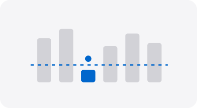
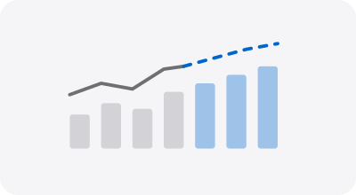
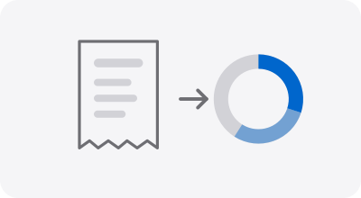
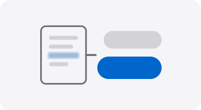
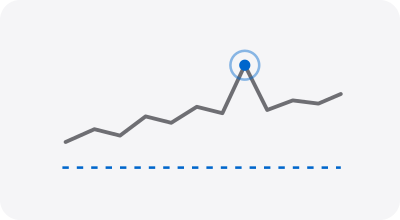

# Cenk Akın

**Python &amp; AI engineer · FastAPI · data pipelines · automation that runs itself**

Vancouver, BC

  

---

I build backend services, data pipelines and AI agents in Python. My focus is software that solves operational problems: inventory, forecasting, staffing, document processing and monitoring that runs around the clock without anyone watching it.

Before I wrote code, I ran the operations this software is for. I spent eight years in customer operations at **Turkcell Global Bilgi** and **KKTCELL**, where I built a national operator's customer-service and CRM operation from scratch: call centre, back office, IVR and the full KPI framework. That background shapes how I engineer:

- **I start from the workflow.** I model how a warehouse, store or service centre really runs before I design a single table.
- **I ship production-ready.** Migrations, containers, tests, CI, retries and alerting arrive with the first version.
- **I automate the boring parts.** Scheduled services pull data, apply business rules and escalate only what needs a human decision.

## Selected work

<table>
  <tr>
    <td width="33%" valign="top">
      
      <h3><a href="https://github.com/akincenk/Warehouse-AI-Suite-">Warehouse AI Suite</a></h3>
      
Tracks SKUs, suppliers, stock and purchase orders, and flags low inventory before it becomes a stockout.

      
FastAPI · PostgreSQL · SQLAlchemy · Alembic · Docker

    </td>
    <td width="33%" valign="top">
      
      <h3><a href="https://github.com/akincenk/Retail-Demand-Staffing-Optimizer">Demand &amp; Staffing Optimizer</a></h3>
      
Forecasts demand for every store and product, then turns it into a staffing plan that meets service-level targets.

      
FastAPI · PostgreSQL · forecasting · Docker

    </td>
    <td width="33%" valign="top">
      
      <h3><a href="https://github.com/akincenk/warehouse-management-system">Warehouse Management System</a></h3>
      
Inventory and order API with role-based permissions and JWT authentication.

      
FastAPI · SQLAlchemy · JWT · RBAC

    </td>
  </tr>
  <tr>
    <td width="33%" valign="top">
      
      <h3><a href="https://github.com/akincenk/Receipt-OCR-Analytics-Platform">Receipt OCR &amp; Analytics</a></h3>
      
Turns receipts into structured data and serves spend analytics by vendor, category and period.

      
Tesseract OCR · FastAPI · PostgreSQL · Docker

    </td>
    <td width="33%" valign="top">
      
      <h3><a href="https://github.com/akincenk/insightai">InsightAI</a></h3>
      
Ask a question in plain English and get the answer straight from a stack of PDFs.

      
Vector search · OpenAI · PyMuPDF · FastAPI

    </td>
    <td width="33%" valign="top">
      
      <h3><a href="https://github.com/akincenk/Tradewatch">Tradewatch</a></h3>
      
Streams market trades in real time and surfaces unusual activity on a live dashboard.

      
WebSockets · Redis · Plotly Dash · Pytest

    </td>
  </tr>
</table>

**Private builds** · code not public, happy to walk through them

- **Personal AI assistant.** Local-first, runs 24/7 on my own hardware, with source-linked memory, one-command agents, encrypted storage and strict spending limits.
- **Multi-model AI council.** Several language models debate a question and return one reviewed answer.
- **Unattended monitoring pipelines.** A family of GitHub Actions services that watch public data sources on a schedule, filter by business rules and alert by email, Telegram or voice, with retry and outage handling built in.

## Background

| Years | Role |
|---|---|
| 2012 – present | Independent software engineer: Python, FastAPI, data and AI automation |
| 2011 – 2012 | Unit Supervisor, Turkcell Global Bilgi |
| 2010 – 2011 | Operations Manager, Customer Services &amp; CRM, KKTCELL: built the operation from zero |
| 2004 – 2010 | Unit Supervisor, Turkcell Global Bilgi |

## Toolbox

  
  
  
  
  
  

  
  
  
  
  

  
  
  
  
  

## GitHub activity

  <picture>
    <source media="(prefers-color-scheme: dark)" srcset="https://github-readme-stats.vercel.app/api/top-langs/?username=akincenk&layout=compact&hide_border=true&card_width=380&langs_count=6&theme=github_dark" />
    
  </picture>
  <picture>
    <source media="(prefers-color-scheme: dark)" srcset="https://streak-stats.demolab.com?user=akincenk&hide_border=true&theme=github-dark-blue" />
    
  </picture>

---

*Good software is readable. Complexity is not a skill, it's a mistake.*

