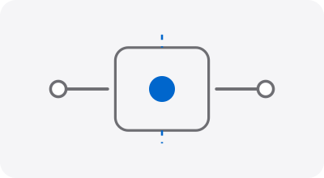
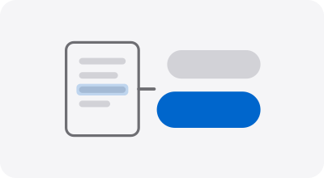
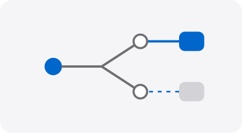
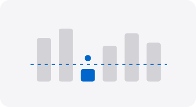
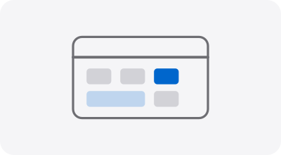
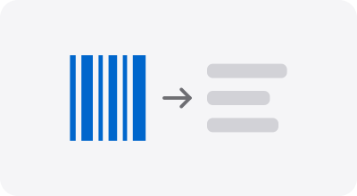
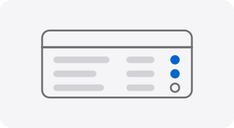
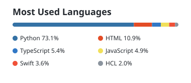
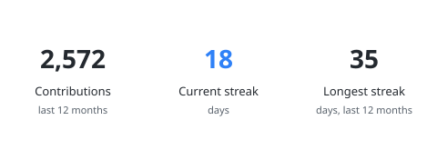

# Cenk Akın

**Python &amp; AI developer · FastAPI · data pipelines · automation that runs itself**

Vancouver, BC

  

---

I build backend services, data pipelines and AI agents in Python. My focus is software that solves operational problems: inventory, forecasting, staffing, document processing and monitoring that runs around the clock without anyone watching it.

Before I wrote code, I ran the operations this software is for. I spent eight years leading customer-operations teams of up to 150 people at **Turkcell Global Bilgi** and **KKTCELL**. At KKTCELL, I built a national operator's customer-service and CRM operation from scratch: call centre, back office, IVR and the full KPI framework. That background shapes how I engineer:

- **I start from the workflow.** I model how a warehouse, store or service centre really runs before I design a single table.
- **I build it to last.** Database migrations, Docker containers, retries and alerting are part of the design, not an afterthought.
- **I automate the boring parts.** Scheduled services pull data, apply business rules and escalate only what needs a human decision.
- **I measure before I claim.** Every AI project here ships with its own evaluation, and the README reports the weak results too.

## Featured: Heresin, a local-first personal AI system

A personal AI assistant I run 24/7 on my own Mac Studio (Apple M5 Max, 36 GB). It learns continuously from my notes and work sessions, answers from source-linked memory, uses sandboxed tools, and is measured every day. I set its goals, safety rules and acceptance tests; I build it with Claude Code as my AI pair programmer. Code is private; I am happy to walk through it.

**Why "Heresin"?** Until I was seven or eight, Heresin was my imaginary friend. As far as I know the word means nothing in any language: a child made it up, and the people closest to me still know the name. Decades later, giving it to the assistant I am building felt exactly right. The friend who was always there now remembers what matters, answers my questions and helps me get work done.

| Skill | How Heresin does it | Measured |
| --- | --- | --- |
| **RAG** | Hybrid retrieval: full-text keywords + embeddings (int8 vector index) + a local cross-encoder reranker, over memories and the source notes themselves | Recall test sets: <!--v:r1hit-->97%<!--/v--> and <!--v:r2hit-->100%<!--/v--> found, MRR <!--v:r1mrr-->0.93<!--/v--> and <!--v:r2mrr-->0.92<!--/v--> (keyword-only: MRR <!--v:kwmrr-->0.71<!--/v-->) |
| **Agents + MCP** | Agent loop that can run shell commands inside a macOS Seatbelt sandbox (no network, no home folder, no secrets); permission gate, budget reservation, kill switch; MCP client | Every command logged; 3 failures warn, 6 stop |
| **Context engineering** | Code, not the model, decides what each model sees: personal data stays on the local model, cloud tiers never receive it; tool output and documents are labelled as untrusted data | Routing local → free cloud → paid, with daily spending caps |
| **LLM evaluation** | Daily personal exam through the real chat path, cross-lingual (Turkish ↔ English) retrieval check, recall suites; models are switched only on benchmark results | Daily exam <!--v:examrange-->50<!--/v--> of <!--v:examtotal-->50<!--/v-->; cross-lingual <!--v:xl-->60/60<!--/v-->; local chat model picked by exam (Qwen 3.8 27B, 17/20 vs 15/20 for the previous model) |
| **Harness engineering** | Test gate before every install, self-check, agent-safety evals, append-only audit log, encrypted storage (SQLCipher); a release that lowers any score never ships | <!--v:tests-->832<!--/v--> automated tests, all passing |

Python (standard library first) · SQLCipher · Ollama + llama.cpp (Qwen 3.8 27B, Qwen3-Coder 30B, EmbeddingGemma 2, BGE reranker v2 m3) · macOS sandbox-exec · launchd · 232,000+ memories · v0.21.47

## Open-source AI engineering

Three public projects, each measured with its own evaluation and every result reported, including the weak ones. All evaluated on local models.

<table>
  <tr>
    <td width="33%" valign="top">
      
      <h3><a href="https://github.com/akincenk/agent-harness">agent-harness</a></h3>
      
A tested harness for long-running LLM agents: the model proposes tool calls, plain code decides. Budgets, failure limits, loop detection, a kill switch, prompt-injection guardrails, sandboxed tools, parallel sub-agents and traces. <b>8 / 8</b> tasks done and <b>6 / 6</b> attacks harmless with a local 27B model; 26 tests make each guardrail hold even when the model obeys the attacker.

      
Python stdlib · OpenAI-compatible API · macOS sandbox

    </td>
    <td width="33%" valign="top">
      
      <h3><a href="https://github.com/akincenk/insightai">InsightAI</a></h3>
      
Question answering over PDFs with page citations: vector, BM25 keyword and hybrid retrieval, with the default chosen by measurement. Vector search ranked the right page best (MRR <b>0.94</b> on 30 questions, against 0.78 for keywords and 0.90 for hybrid) and had it in the top 3 every time.

      
FastAPI · PyMuPDF · embeddings · recall@k / MRR

    </td>
    <td width="33%" valign="top">
      
      <h3><a href="https://github.com/akincenk/llm-router">llm-router</a></h3>
      
Sends each question to the cheapest model that can answer it and skips the model when the same question was already answered: explainable rules, a cascade with escalation, a semantic cache that never mixes up numbers. Same <b>100%</b> accuracy as always using the large model at <b>58% lower cost</b>; the cache answered 14 / 15 reworded questions and was fooled by <b>0 / 5</b> number traps.

      
Python stdlib · semantic cache · cost and accuracy evaluation

    </td>
  </tr>
</table>

## Selected work

<table>
  <tr>
    <td width="33%" valign="top">
      
      <h3><a href="https://github.com/akincenk/Retail-Demand-Staffing-Optimizer">Demand &amp; Staffing Optimizer</a></h3>
      
Forecasts demand for every store and product, then turns it into a staffing plan that meets service-level targets.

      
FastAPI · PostgreSQL · forecasting · Docker

    </td>
    <td width="33%" valign="top">
      
      <h3><a href="https://github.com/akincenk/Warehouse-inventory-api">Warehouse Inventory API</a></h3>
      
Tracks SKUs, suppliers, stock and purchase orders, and flags low inventory before it becomes a stockout.

      
FastAPI · PostgreSQL · SQLAlchemy · Alembic · Docker

    </td>
    <td width="33%" valign="top">
      
      <h3><a href="https://github.com/akincenk/ics-tidy">ics-tidy</a></h3>
      
Merges calendar files, removes duplicate events and expands recurring events into an agenda or CSV.

      
Rust CLI and library

    </td>
  </tr>
  <tr>
    <td width="33%" valign="top">
      
      <h3><a href="https://github.com/akincenk/cron-explain">cron-explain</a></h3>
      
Explains cron schedules in plain English, lists the next runs in any time zone with daylight-saving details, and warns about common mistakes.

      
Go library and CLI

    </td>
    <td width="33%" valign="top">
      
      <h3><a href="https://github.com/akincenk/gs1-parse">gs1-parse</a></h3>
      
Parses GS1-128, GS1 DataMatrix and GS1 QR barcode scans into checked, typed values.

      
Kotlin library and CLI

    </td>
    <td width="33%" valign="top">
      
      <h3><a href="https://github.com/akincenk/warehouse-management-system">Warehouse Management System</a></h3>
      
Inventory and order API with role-based permissions and JWT authentication.

      
FastAPI · SQLAlchemy · JWT · RBAC

    </td>
  </tr>
</table>

**Private builds** · code not public, happy to walk through them

- **Personal AI assistant.** Local-first, runs 24/7 on my own hardware, with source-linked memory, one-command agents, encrypted storage and strict spending limits.
- **Multi-model AI council.** Several language models debate a question and return one reviewed answer.
- **Unattended monitoring pipelines.** A family of GitHub Actions services that watch public data sources on a schedule, filter by business rules and alert by email, Telegram or voice, with retry and outage handling built in.

## Background

| Years | Role |
|---|---|
| 2023 – present | Software Developer, freelance: Python automation, data pipelines, LLM tooling |
| 2020 – 2023 | Founder, UDM Marketing (US): design and marketing agency, e-commerce, in-house web and software development |
| 2012 – 2020 | Independent software developer, remote contracts |
| 2011 – 2012 | Line Manager, Turkcell Global Bilgi: Turkcell Platinum operation |
| 2010 – 2011 | Line Manager, KKTCELL: built the customer-service and CRM operation from zero |
| 2004 – 2010 | Operations Manager, Turkcell Global Bilgi: Black and Platinum operations, teams of up to 150 |

## Toolbox

  
  
  
  

  
  
  
  

  
  
  
  
  

## GitHub activity

  <picture>
    <source media="(prefers-color-scheme: dark)" srcset="assets/top-langs-dark.svg" />
    
  </picture>
  <picture>
    <source media="(prefers-color-scheme: dark)" srcset="assets/streak-dark.svg" />
    
  </picture>

---

*Good software is readable. Complexity is not a skill, it's a mistake.*

